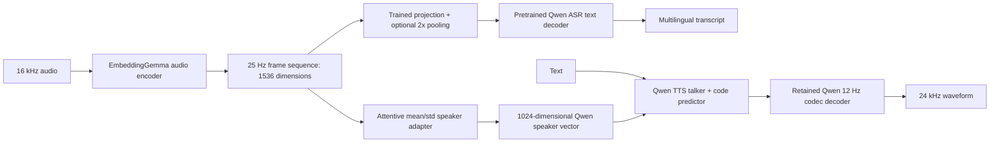

# Gemma Speech

An independent research package for **Arabic-first, multilingual, offline ASR and TTS**, using EmbeddingGemma 2 with the two requested Qwen 0.6B checkpoints. All components run in **one Python environment: PyTorch 2.11.0 and Transformers 5.19.0**. There is no dependency on `qasr`, `qwen-asr`, or the version-pinned `qwen-tts` SDK.

This is training and inference code, not a newly trained speech checkpoint. Pretrained integration and synthetic training tests pass; accuracy, voice similarity, Arabic pronunciation, H100 throughput, and 96-GPU scaling still require evaluation on real data. [Research rationale](docs/research.md) and [verification evidence](verification/README.md) distinguish these claims.

## Project layout and cluster execution

`gemma_speech` is the parent project. `gqasr/` contains the ASR package, QASR v8.1 manifest configs and standalone base-export workflow; `gqtts/` contains the TTS speaker/talker package and its configs. Shared utilities and the compatible private TTS runtime remain under `src/gemma_speech/`. One parent installation provides all three commands: `gqasr`, `gqtts` and `gemma-speech`.

Use the **[cluster runbook](cluster/README.md)** for setup, downloads, base export, verification, manifest scanning, 12-node training and resume. All model execution is intended for the cluster. Generated weights are not committed. The older experiment commands below remain available for reference; the new GQASR training recipe is documented in [gqasr/README.md](gqasr/README.md).

## Implemented architecture



The ASR replacement removes Qwen's audio tower and keeps its tokenizer, causal decoder and language-model head. The TTS replacement bypasses Qwen's reference speaker encoder through its existing voice-clone prompt interface. Its codec stays intact. Neither path uses a pooled sentence embedding as a speech sequence.

The Gemma audio encoder is about 305M parameters. It replaces a roughly 186M ASR encoder or an 8.9M TTS speaker encoder. The implemented ASR hybrid is **901.9M parameters**, including a 0.99M bridge; the speaker adapter is 2.30M. This is an architectural experiment, not an automatic compression or speed improvement. The Python model classes expose the audio component so an application can share one instance; the separate convenience CLI commands each load their own models.

## One environment

Run from the repository root with Python 3.11–3.13 (tested with 3.13). On H100 Linux machines with your CUDA 12.9 installation:

```bash
python3 -m venv gemma_speech/.venv
source gemma_speech/.venv/bin/activate
python -m pip install --upgrade pip
python -m pip install torch==2.11.0 --index-url https://download.pytorch.org/whl/cu128
python -m pip install -e './gemma_speech[dev]'
python -m pip check
```

The CUDA 12.8 PyTorch wheel supplies its runtime; the host driver must support it. The installed toolkit version alone does not establish driver compatibility. Check `nvidia-smi`, `torch.cuda.is_available()` and `torch.cuda.is_bf16_supported()` on a node before launch. No FlashAttention build is required; the Qwen port uses PyTorch SDPA. Start with BF16, never FP16 for the Gemma encoder.

On a CPU development machine, omit the CUDA-wheel command. The same package and Transformers version are used. For reproducibility, capture the fully resolved environment with `python -m pip freeze > environment.lock.txt` after installation and use it on every node.

The upstream Qwen TTS 0.1.1 code needs actual Transformers 5 API adaptations, not just removal of its version pin. The required 12 Hz implementation is included under a private namespace with its Apache license, original file hashes, and [change notice](src/gemma_speech/_vendor/qwen_tts/NOTICE.md). There are no global Transformers monkey patches. The 25 Hz model is outside this port's scope.

## Download once, run offline

```bash
gemma-speech prefetch --output gemma_speech/models/embeddinggemma2
gemma-speech prefetch --qwen-asr --output gemma_speech/models/qwen-asr
gemma-speech prefetch --qwen-tts --output gemma_speech/models/qwen-tts
export HF_HUB_OFFLINE=1
```

Revisions are pinned in the package. Make these directories available at the same path on each node, either shared storage or local staging. The provided Qwen ASR configs resolve `../models/...` relative to their config file. ASR output checkpoints embed the decoder, audio encoder, tokenizers and frontend configuration; their inference does not require upstream downloads. TTS inference needs the local Qwen codec/base directory, Gemma weights, trained speaker adapter, and optionally the adapted talker checkpoint.

## Dataset contract

UTF-8 JSONL, one utterance per line:

```json
{"id":"ar-000001","audio":"audio/ar-000001.wav","text":"مرحبا بالعالم","tts_text":"مَرْحَبًا بِالْعَالَمِ","language":"ar","speaker":"speaker-001","recording_id":"session-001","dialect":"msa"}
```

`audio` is relative to the manifest; `audio_filepath` and `speaker_id` aliases are accepted. TTS requires an explicit speaker ID. `tts_text` defaults to `text`. Preserve diacritics in TTS targets when available. Use language codes `ar`, `en`, `hi`, `zh`, `ml` for the initial scope. All configured languages must actually exist in training; no dummy multilingual rows are added.

Use disjoint recordings across train/validation/test; speaker-adapter validation should also hold out speakers. ASR manifests are checked for recording, path and ID overlap. Speaker/codec caches additionally check audio hashes across training and validation. Segment long inputs before training; overlong audio or text raises an error instead of silently truncating it.

## ASR: bridge training, then adaptation

Provide `data/asr_train.jsonl` and `data/asr_validation.jsonl` under the package directory, or edit the config paths.

```bash
gemma-speech inspect --config gemma_speech/configs/qwen_asr_bridge.json
gemma-speech validate --config gemma_speech/configs/qwen_asr_bridge.json
gemma-speech train --config gemma_speech/configs/qwen_asr_bridge.json

gemma-speech train --config gemma_speech/configs/qwen_asr_adapt.json \
  --init-checkpoint gemma_speech/outputs/qwen_asr_bridge/last.pt

gemma-speech transcribe \
  --checkpoint gemma_speech/outputs/qwen_asr_adapt/last.pt \
  --manifest gemma_speech/data/asr_test.jsonl \
  --output gemma_speech/outputs/asr-test.jsonl --device cuda:0
```

Stage one freezes both pretrained components and learns the bridge. Stage two opens the final four Gemma layers and four Qwen decoder layers at a lower learning rate. These are starting hyperparameters, not measured optimal settings. The bridge keeps 25 Hz or pools to approximately 12.5 Hz (`qwen_audio_stride=1` versus `2`); compare both for Arabic consonant/vowel distinctions.

Training uses language-prefixed transcripts and teacher forcing. Evaluation generates transcripts without giving the model the reference transcript or reference language prefix. Report strict and Arabic-normalized WER/CER separately, including language/dialect groups and silent-reference hallucinations. The normalizer is an explicit evaluation view; it does not rewrite training labels.

## TTS: speaker adaptation and Arabic synthesis training

First cache **Gemma frame features, Qwen speaker targets, and Qwen codec targets in the same environment**:

```bash
gemma-speech speaker-cache --manifest gemma_speech/data/tts_train.jsonl \
  --output gemma_speech/data/speaker-train-cache \
  --gemma gemma_speech/models/embeddinggemma2 --qwen gemma_speech/models/qwen-tts \
  --device cuda:0 --include-codes

gemma-speech speaker-cache --manifest gemma_speech/data/tts_validation.jsonl \
  --output gemma_speech/data/speaker-val-cache \
  --gemma gemma_speech/models/embeddinggemma2 --qwen gemma_speech/models/qwen-tts \
  --device cuda:0 --include-codes

gemma-speech speaker-train --config gemma_speech/configs/qwen_speaker.json
gemma-speech qwen-tts-train --config gemma_speech/configs/qwen_tts_arabic.json
```

For parallel caching, give each process a unique `--shard R --shards N`; use the same shard count and model paths for train and validation. Each process owns its files. The trainer rejects incomplete or mixed caches. Cache extraction and adapters currently use frozen Gemma audio features; end-to-end speaker fine-tuning is a later ablation.

The speaker adapter learns both the direction and scale of Qwen's native speaker vector through cosine and relative-MSE losses. The talker trainer then predicts the first codec stream and the remaining 15 streams, with explicit next-frame/codebook alignment and frozen speaker conditioning. It includes the 0.6B model's text projection. Cached codec targets avoid running the codec during gradient updates.

Arabic, Hindi and Malayalam are **not listed languages of the original Qwen TTS checkpoint**. The talker training path uses Qwen's existing `Auto` prompt format to learn them from paired text/audio, alongside multilingual replay; it does not invent a reserved language token. `Auto` alone on an unadapted model is not evidence of Arabic support.

```bash
gemma-speech qwen-synthesize \
  --checkpoint gemma_speech/outputs/qwen_speaker/last.pt \
  --talker-checkpoint gemma_speech/outputs/qwen_tts_arabic/last.pt \
  --audio /absolute/path/to/reference.wav \
  --gemma gemma_speech/models/embeddinggemma2 --qwen gemma_speech/models/qwen-tts \
  --text 'مَرْحَبًا بِالْعَالَمِ' --language Auto \
  --output gemma_speech/outputs/arabic.wav --device cuda:0
```

Omit `--talker-checkpoint` to measure speaker replacement on a language the base model already supports. This path uses speaker-vector-only voice cloning; it intentionally does not consume reference codec tokens or reference transcripts. Arabic pronunciation, diacritization, dialect and cross-language voice retention need held-out listening tests.

## Your 12 × 8 H100 cluster

The supplied launcher starts eight workers per node, with 12 nodes by default. Launch this on every node with its unique rank:

```bash
MASTER_ADDR=node0 NODE_RANK=0 bash gemma_speech/scripts/torchrun_node.sh \
  /shared/qasr/gemma_speech/configs/qwen_asr_bridge.json
```

Use `NODE_RANK=1` through `11` on the others. For TTS set `SPEECH_TRAIN_COMMAND=speaker-train` or `SPEECH_TRAIN_COMMAND=qwen-tts-train`; the default command is `train`. A Slurm wrapper is also provided:

```bash
sbatch gemma_speech/scripts/slurm_12node.sh /shared/qasr/gemma_speech/configs/qwen_asr_bridge.json
```

ASR and talker examples use two utterances per GPU, giving 192 global examples at 96 GPUs; speaker-adapter training uses 32, giving 3072. Measure before increasing these. Four data-loader workers and two numerical threads per GPU leave CPU headroom on your 96-core nodes. Set networking/NCCL interface variables to match your cluster; the package does not guess them.

Use one node for initial bridge/speaker ablations and a real-data overfit check, then validate two nodes before launching all 12. DDP is sufficient for these parameter sizes; full FSDP/ZeRO machinery is not included. Checkpoints are written by rank zero, with shared output paths. Resume into a **new** output directory with `--resume`; ASR `--init-checkpoint` starts a new fine-tuning stage and resets the optimizer.

## Comparison models and tests

`configs/asr_frozen.json` implements an approximately 319M Gemma-audio CTC baseline. `configs/tts_semantic.json` implements an experimental lexical-plus-Gemma-text flow-matching mel model, with known-speaker conditioning and learned duration. These are comparison architectures, separate from the requested Qwen hybrid. Train their byte-fallback SentencePiece tokenizer with `gemma-speech tokenizer`; use only training text. The optional `vocoder` extra provides Vocos with matched torchaudio 2.11.0; it is not used by the Qwen TTS path.

```bash
python -m pytest gemma_speech/tests -q
gemma-speech smoke --output /tmp/gemma-speech-smoke-new
python gemma_speech/scripts/verify_pretrained.py \
  --gemma gemma_speech/models/embeddinggemma2 \
  --qwen-asr gemma_speech/models/qwen-asr --qwen-tts gemma_speech/models/qwen-tts \
  --output /tmp/gemma-speech-pretrained-check.json
```

The last command exercises all three real pretrained checkpoints in one process, including Gemma→Qwen ASR gradients, speaker distillation, codec encode/decode, and Gemma-conditioned TTS generation. Its input is synthetic audio. It must not be treated as a speech-quality benchmark.
